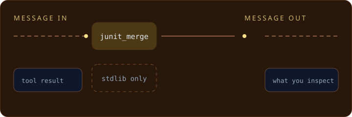

<p align="center">
  
</p>

<p align="center">
  <a href="https://pypi.org/project/junit-merge/"></a>
  <a href="https://pypi.org/project/junit-merge/"></a>
  <a href="https://pypi.org/project/junit-merge/"></a>
  <a href="https://github.com/sandeshbagmare/junit-merge/actions/workflows/ci.yml"></a>
  <a href="https://github.com/sandeshbagmare/junit-merge/blob/main/LICENSE"></a>
  <a href="https://sandeshbagmare.github.io/junit-merge/"></a>
  <a href="https://pypi.org/project/junit-merge/"></a>
</p>

<h3 align="center">merge JUnit XML from every job into one honest report</h3>
<p align="center"><em>Standard library only. No runtime dependencies. Python 3.9+.</em></p>

<p align="center">
  
</p>

## Duplicate tests

A test that appears in more than one report (the usual result of a retry) is
resolved with `on_duplicate`:

| policy | behaviour |
| ------ | --------- |
| `keep-worst` (default) | keep the failure or error over the pass; a test that failed anywhere stays failed |
| `keep-first` | keep the first occurrence |
| `keep-last` | keep the last occurrence |
| `keep-both` | keep every occurrence |
| `fail` | raise, naming the test, instead of guessing |

Keeping the worst outcome is the safe default: a flaky retry cannot hide a real
failure from the report.

## Install

```console
pip install junit-merge
```

## API

```python
from junit_merge import merge, merge_files, parse, parse_file, to_xml

report = parse_file("shard-1.xml")  # Report
merged = merge([report, parse_file("shard-2.xml")], on_duplicate="keep-worst")
merged.tests, merged.failures, merged.errors, merged.skipped, merged.time
data = to_xml(merged)  # bytes, valid <testsuites> document
```

`parse` accepts `str`, `bytes`, a path is handled by `parse_file`, and a document
name-spaced by tools like Jenkins is understood. Invalid XML raises `ValueError` with
the reason, not a bare `ParseError`.

## What is preserved

- `classname`, `name`, `time`, `file`, `line`
- `<failure>`, `<error>` and `<skipped>` including `message` and the text body
- `<system-out>` and `<system-err>`
- suite `<properties>`, first value winning on a clash

Cases are sorted by class and name by default, so two runs of the same merge produce
identical bytes; pass `sort=False` to keep the input order.

## What is not

- It does not run tests, retry them or upload anything: it merges files.
- Attributes nobody sets from test cases (`timestamp`, `hostname`) are not invented.
- A report whose contents contradict each other is trusted on the cases, which is
  the only part that can be verified.

## Development

```console
python -m venv .venv
.venv/bin/pip install -e ".[test]"
.venv/bin/pytest
```

## License

MIT.
